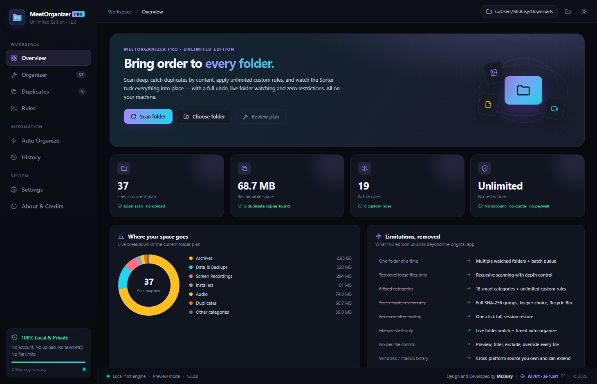
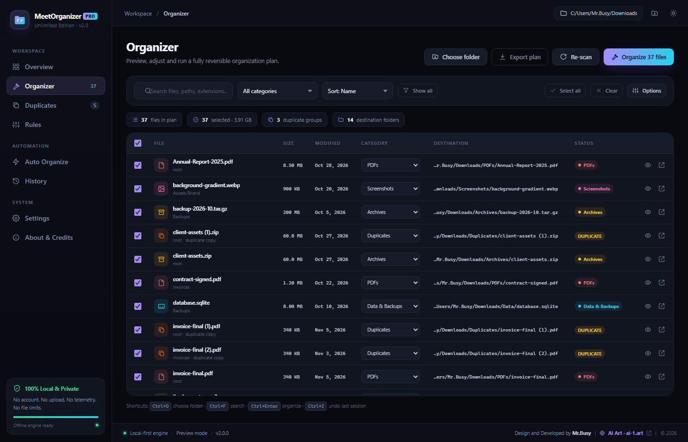

# MeetOrganizer Pro

**Version 2.0.0** — an unlimited, local-first desktop file organizer for Windows, macOS and Linux.

A complete redesign of the original [MeetOrganizer](https://shipwithajay.com/products/meetorganizer/) (a small Downloads-only tidy-up tool). Same idea, every restriction removed, plus a modern multi-view interface.

> **Private repository** — `mrbusy1/MeetOrganizer`. Source only; built binaries are intentionally not tracked (see [Building](#building)).





---

## Why this exists

The original app is deliberately minimal: it watches a single Downloads folder, only sees loose top-level files, offers a handful of fixed categories, and cannot undo a sort. MeetOrganizer Pro keeps the one-click simplicity but removes the ceiling.

| Original limitation | MeetOrganizer Pro |
| --- | --- |
| One folder at a time | Multiple watched folders + batch queue |
| Top-level loose files only | Recursive scanning with depth control |
| 6 fixed categories | 18 smart categories + unlimited custom rules |
| Size + hash, review only | Full SHA-256/SHA-1/MD5 groups, keeper choice, Recycle Bin |
| No undo after sorting | One-click full session restore |
| Manual start only | Live folder watch + timed auto-organize |
| No per-file control | Preview, filter, exclude, override every file |
| Closed Windows/macOS binary | Cross-platform source you own and can extend |

No account, no quota, no paywall, no telemetry, no cloud upload. File operations happen entirely on your machine; the only outbound action is opening an external link (for example `ai-1.art`) in your default browser when you click it.

---

## Features

**Scanning** — pick one folder or build a multi-folder watchlist; recursive scan with configurable max depth, hidden-file toggle, minimum size, glob exclusions (`*.tmp`, `*.crdownload`, …), and skipping of already-organized category folders.

**Rules** — 18 built-in categories (Screenshots, Screen Recordings, Images, Videos, Audio, PDFs, Documents, Spreadsheets, Presentations, Ebooks, Archives, Installers, Code & Web, Design Files, Fonts, Data & Backups, Torrents, Duplicates) plus an "Other Files" fallback. Create unlimited custom rules matched by extension, filename regex, size range, or file age, with priority ordering, enable/disable, colors and icons.

**Organizer** — a full plan preview before anything moves: search, filter, sort, per-file include/exclude and category override. Optional date subfolders (`YYYY/MM`), preserve-nested-structure mode, and rename / skip / overwrite conflict policies.

**Duplicates** — streaming content hashing (SHA-256 by default, SHA-1 or MD5 selectable), grouped results, pick which copy to keep, then move the rest to a Duplicates folder or the system Recycle Bin.

**Sorter** — animated progress with pause, resume and cancel, adjustable speed, live counters per destination bucket.

**Undo & history** — every move is written to a JSON journal in Electron's `userData` directory. Restore an entire session with one click, including files sent to category folders or Duplicates.

**Auto Organize** — `fs.watch`-based live folder monitoring with debounce, scheduled sweeps at a chosen interval, and a running activity log.

**Dashboard & exports** — category breakdown donut chart, totals, recent activity, limitation-removal comparison, and CSV / JSON plan export.

**Appearance** — dark and light themes, four accent colors, persisted locally.

**GitHub card** — bottom-left of the sidebar: the `mrbusy1/MeetOrganizer` repo link, a **Give a star** button that opens the repository (the star state is remembered locally), a **Share** button that copies the repo link to the clipboard, plus shortcuts to the `mrbusy1` profile and Releases. The About & Credits screen repeats these links.

### Views

| View | Purpose |
| --- | --- |
| Overview | Scan, stats, category chart, quick actions |
| Organizer | Review and run a reversible organization plan |
| Duplicates | Content-verified groups and keeper selection |
| Rules | Built-in and unlimited custom rules |
| Auto Organize | Watchers, scheduler, activity log |
| History | Session journals and one-click undo |
| Settings | Scan, hash, conflict, animation, theme, storage |
| About & Credits | Version, credits, original-app comparison |

---

## Requirements

- **Node.js 18+** and npm
- Windows 10/11, macOS or Linux (built and verified on Windows x64)
- No other runtime, database or service is required

## Quick start

```bash
git clone https://github.com/mrbusy1/MeetOrganizer.git
cd MeetOrganizer
npm install
npm start
```

On Windows you can also just **double-click `START.bat`** — it installs Electron on first launch if needed and starts the app.

The app opens on the Overview and defaults to your Downloads folder. Nothing is moved until you review the plan and confirm.

### Browser preview (no file access)

Open `src/index.html` directly in a browser, or append `?view=<name>` (e.g. `?view=rules`, `?view=organizer`, `?view=about`). `src/demo.js` provides an in-memory mock of the same `window.MO` API with sample files, so all eight views stay interactive without touching your real files.

### Scripts

| Command | What it does |
| --- | --- |
| `npm start` | Launch the desktop app |
| `npm run dev` | Launch with detached DevTools |
| `npm run smoke` | Built-in self-test: verifies window, preload bridge and IPC, then exits |
| `npm run dist` | Build unpacked Windows app into `dist/win-unpacked/` |
| `npm run dist:portable` | Build single-file portable `.exe` into `dist-portable/` |
| `npm run dist:installer` | Build the NSIS Setup installer into `dist-nsis/` |

`launch.js` clears `ELECTRON_RUN_AS_NODE` before spawning Electron — some tool environments export it, which makes `require('electron')` return a plain path string and crashes the app. `START.bat` does the same.

---

## Building

```bash
npm install
npm run dist            # dist/win-unpacked/MeetOrganizer Pro.exe  (keep the whole folder)
npm run dist:portable   # dist-portable/MeetOrganizer Pro 2.0.0.exe (single file, no install)
```

`electron-builder` config lives in the `build` field of `package.json` (`appId`, icon, asar, file allowlist). The portable target needs a fresh output directory; if a previous `win-unpacked` folder is locked or cannot be cleaned, delete it manually or point `-c.directories.output` at a new path.

To target macOS or Linux, add the corresponding `electron-builder` target flags; the source itself is platform-neutral (`path` / `fs` APIs throughout).

### Windows installer

`npm run dist:installer` builds **MeetOrganizer-Pro-Setup-2.0.0.exe** with NSIS. It is a normal per-user installer: welcome screen, choice of install directory, Start Menu and desktop shortcuts, and a proper uninstaller — no administrator rights required. The installer and uninstaller use `assets/icon.ico` (16/32/48/64/128/256 px).

Published binaries live in the [`release/`](release/) folder and are attached to the [GitHub Releases](https://github.com/mrbusy1/MeetOrganizer/releases) page of this private repository:

| File | Use |
| --- | --- |
| `MeetOrganizer-Pro-Setup-2.0.0.exe` | Standard Windows installer (recommended) — Release asset |
| `MeetOrganizer-Pro-2.0.0-Portable.exe` | Single-file app, no installation — Release asset |
| `SHA256SUMS.txt` | Verify either download before running |
| `manifest.json` | Version, build date, sizes and hashes of the published artifacts |

The two `.exe` files live in `release/` locally and are uploaded as GitHub Release assets; they are deliberately not committed (GitHub caps single files at 100 MB and large pushes are unreliable). `SHA256SUMS.txt` and `manifest.json` are tracked so the published binaries remain verifiable.

---

## Architecture

| File | Responsibility |
| --- | --- |
| `main.js` | Electron main process: recursive scan, streaming hash, safe move/rename, Recycle Bin, JSON undo journals, `fs.watch` watchers, exports, file preview, window controls, self-test |
| `preload.js` | `contextBridge` exposing the `window.MO` IPC API (context isolation on, `nodeIntegration` off) |
| `src/engine.js` | Pure logic: default rules, classification, plan building, duplicate grouping, formatting, inline SVG icon set |
| `src/app.js` | Renderer: all eight views, state, event handling, themes, settings persistence |
| `src/styles.css` | Full design system — dark/light themes, accents, responsive layout |
| `src/demo.js` | In-memory mock of `window.MO` for the browser preview |
| `src/index.html` | App shell, navigation, persistent footer credit |
| `launch.js` | Cross-platform launcher that neutralizes `ELECTRON_RUN_AS_NODE` |
| `START.bat` | One-click Windows launcher |

Settings, rules and session journals are stored locally in Electron's `userData` directory — nothing is synced.

### Keyboard shortcuts

| Shortcut | Action |
| --- | --- |
| `Ctrl/Cmd + O` | Choose folder |
| `Ctrl/Cmd + F` | Focus the file filter |
| `Ctrl/Cmd + Enter` | Run the current plan |
| `Ctrl/Cmd + Z` | Undo the last session (outside text fields) |
| `Esc` | Close the active dialog |

### Safety

The plan is a preview until you confirm. Moves are journaled before completion, name conflicts follow your chosen policy, deletions use the OS Recycle Bin, and a full session restore is always one click away. Start with a test folder if you want to see the behaviour first.

---

## Credits

**Design and Developed by Mr.Busy**

**AI Art — The Ultimate AI Tool Directory & Prompt Gallery**: https://ai-1.art/

The footer credit is present in every view and repeated on the About & Credits screen.

Original product reference: https://shipwithajay.com/products/meetorganizer/

License: MIT (as declared in `package.json`).
